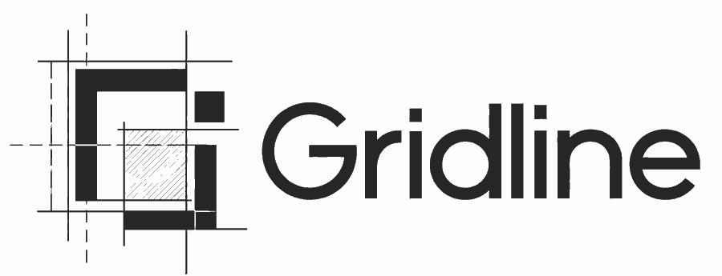
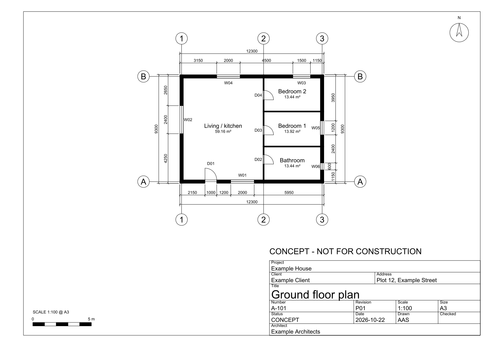

<div align="center">



### From brief to blueprint to handover.

**30 portable AI Agent Skills + 12 specialist agents for architecture, BIM, CAD and multidisciplinary AEC workflows.**

[](https://github.com/MakeItEzzz555/Gridline/actions/workflows/ci.yml)


[](LICENSE)

**[Copy the install prompt](#install-with-your-ai-agent-copy-once)** · **[Skills](#the-30-superpowers)** · **[Drawings](#coordinated-cad-drawings)** · **[Tools](#cad--bim--aec-tools)** · **[Research](docs/RESEARCH.md)**

</div>

---

Gridline gives capable AI coding/agent tools a structured way to help with the **full building-project lifecycle**: programming and feasibility, site analysis, concept design, plans/sections/elevations, BIM/CAD workflows, structural/MEP/civil coordination, technical documentation, performance, quantities/cost, construction administration, handover and post-occupancy.

It is not one giant “act like an architect” prompt. Each specialist is discovered only when relevant, keeping the always-loaded context small and the workflow auditable.

## Install with your AI agent — copy once

**No terminal knowledge required.** Open Codex, Claude Code, Gemini CLI, Cursor, OpenCode, Copilot, or another filesystem-capable agent and paste this:

<!-- AGENT_INSTALL_PROMPT_START -->
```text
Install Gridline for my current user.
Official source: https://github.com/MakeItEzzz555/Gridline

First inspect the official README, INSTALL_PROMPT.md, skills/manifest.json and installer/provider docs. Detect which compatible agent runtimes are already installed.

Prefer the standard Agent Skills installer when supported:
npx skills@latest add MakeItEzzz555/Gridline --all -g

Otherwise use this repository's documented native Codex/Claude/Gemini method or reversible global installer. Preserve existing skills/configuration and back up conflicts. Do not use sudo/root, modify my architecture projects, read credentials, delete unrelated skills, or install third-party MCP servers/plugins.

Install only Gridline for the detected hosts. Verify the installed stable-skill count against skills/manifest.json and use documented provider list/validate commands when available. Report PASS/FAIL per host, installed and backup paths, update/uninstall instructions, and whether I need to reload or start a fresh session.

Stop rather than guessing if a command, path, host or permission model is unclear. Do not claim installation succeeded until the filesystem/provider confirms it.
```
<!-- AGENT_INSTALL_PROMPT_END -->

[Full install prompt, alternatives and safety notes](INSTALL_PROMPT.md).
## One command

For Agent Skills hosts supported by the community `skills` installer:

```bash
npx skills@latest add MakeItEzzz555/Gridline --all -g
```

To opt out of that CLI's documented anonymous telemetry:

```bash
DISABLE_TELEMETRY=1 npx skills@latest add MakeItEzzz555/Gridline --all -g
```

### Native provider installs

**Codex**
```bash
codex plugin marketplace add MakeItEzzz555/Gridline
codex plugin add gridline@gridline
```

**Claude Code**
```bash
claude plugin marketplace add MakeItEzzz555/Gridline
claude plugin install gridline@gridline
```

**Gemini CLI**
```bash
gemini extensions install https://github.com/MakeItEzzz555/Gridline
```

Or clone once and let the repository detect installed runtimes:

```bash
git clone https://github.com/MakeItEzzz555/Gridline.git
cd Gridline
bash scripts/install-global.sh auto
```

Windows users can run `powershell -ExecutionPolicy Bypass -File .\scripts\install-global.ps1 auto`.

## The 30 superpowers

### Brief, research and site
| Skill | Use it for |
|---|---|
| `architecture-orchestrator` | End-to-end routing and multidisciplinary synthesis |
| `architecture-programming` | Briefs, rooms, areas, adjacencies and requirements |
| `site-analysis-feasibility` | Survey/context/climate constraints, opportunities and capacity |
| `site-regulation-research` | Planning, zoning and building-control source research |
| `precedent-research` | Evidence-backed architectural case studies and transferable lessons |

### Design and drawing
| Skill | Use it for |
|---|---|
| `concept-schematic-design` | Parti, massing, blocking, plans, sections, elevations and options |
| `concept-design-review` | Critique and compare existing schemes |
| `interior-fitout-design` | Fit-out, furniture/equipment, RCP, finishes and joinery briefs |
| `architectural-drawing-generation` | Site/floor/roof/RCP plans, elevations, sections, details, SVG/DXF |
| `visualization-rendering` | Cameras, lighting, materials, render/animation workflows |
| `presentation-review` | Boards, narratives, jury/client presentation quality |
### CAD, BIM and interoperability
| Skill | Use it for |
|---|---|
| `revit-workflow` | Revit, pyRevit, Dynamo and Revit API |
| `rhino-grasshopper-workflow` | Rhino, Grasshopper, RhinoCommon and parametric geometry |
| `autocad-dwg-workflow` | AutoCAD, DWG, xrefs, layers, blocks, plotting, AutoLISP/.NET |
| `openbim-ifc-coordination` | IFC, BCF, IDS, bSDD, IfcOpenShell/Bonsai and federation |
| `cad-bim-automation` | Generic DXF/SVG/Blender/FreeCAD and cross-platform automation |

### Engineering and performance coordination
| Skill | Use it for |
|---|---|
| `civil-site-design` | Survey, grading, drainage, utilities, roads/parking and Civil 3D |
| `structural-coordination` | Grids, spans, cores, transfers, openings and engineer interfaces |
| `mep-coordination` | Plant, shafts, risers, ceilings, services, penetrations and clashes |
| `life-safety-accessibility` | Sourced egress, fire/life-safety and accessible-route coordination |
| `building-envelope-performance` | Water/air/vapor/thermal layers, facades, roofs and interfaces |
| `sustainability-daylight-energy` | Passive design, daylight, energy, carbon, water and resilience |

### Technical delivery, cost and operation
| Skill | Use it for |
|---|---|
| `construction-documentation` | Drawing sets, schedules, details, revisions and issue packages |
| `drawing-qa` | Cross-sheet drawing QA |
| `materials-specifications` | Materials, finishes, performance requirements and specifications |
| `area-quantity-audit` | Areas, counts, schedules and takeoff reconciliation |
| `cost-planning-value-engineering` | Early cost plans, option deltas and VE registers |
| `construction-administration` | RFIs, submittals, site observations, changes and punch lists |
| `handover-fm-postoccupancy` | O&M, asset data, closeout, FM and POE |
| `architecture-red-team` | Independent final challenge before consequential issue/submission |

[Full lifecycle map](docs/AEC_LIFECYCLE.md).
## Coordinated CAD drawings

When a trusted native CAD/BIM host is available, the skills prefer the native editable model. When it is not, the drawing skill builds a **coordinated drawing set from one building spec**: standard-layered DXF sheets (ISO 13567, US NCS or your office profile) that open in AutoCAD, vector PDFs, and room/door/window schedules and a sheet register. A checker then verifies the files against the standard and against each other before anything is presented.

```bash
pip install ezdxf matplotlib
D=skills/architectural-drawing-generation
python3 $D/scripts/aec_cad.py build $D/references/example-house.building.json /tmp/example-house
python3 $D/scripts/aec_cad.py check $D/references/example-house.building.json /tmp/example-house
```



It draws plans today (walls, doors, windows, rooms, grids, dimensions, sheets); sections, elevations and details are next. For quick diagrams there is also a small dependency-free engine that turns an explicit JSON spec into SVG or DXF. It draws six primitives (lines, rectangles, circles, polylines, text and dimensions), enough for **conceptual** plan and section diagrams. It does not model walls, doors, hatching, title blocks or scale bars:

```bash
python3 skills/architectural-drawing-generation/scripts/aec_draw.py skills/architectural-drawing-generation/references/concept-plan.drawing.json /tmp/plan.svg
python3 skills/architectural-drawing-generation/scripts/aec_draw.py skills/architectural-drawing-generation/references/concept-plan.drawing.json /tmp/plan.dxf
```

The JSON format is documented by [aec-drawing.schema.json](skills/architectural-drawing-generation/references/aec-drawing.schema.json). The fallback never invents dimensions and stamps conceptual output **CONCEPT / NOT FOR CONSTRUCTION** by default. [Drawing-output details](docs/DRAWING_OUTPUTS.md).

## CAD / BIM / AEC tools

The pack knows how to route work for **Revit, pyRevit, Dynamo, Rhino, Grasshopper, AutoCAD, Civil 3D, IFC/IfcOpenShell/Bonsai, DXF/SVG, Blender and FreeCAD**. Public MCP projects also exist for Revit, Rhino/Grasshopper, AutoCAD, Archicad, Vectorworks and SketchUp.

Those integrations are **optional and not installed automatically**. A model-writing bridge can change professional project files; review its source, permissions, network surface and write commands before connecting it.

[Tool-integration policy](docs/TOOL_INTEGRATIONS.md).

## A real project context

Copy [templates/ARCHITECTURE_PROJECT.md](templates/ARCHITECTURE_PROJECT.md) into a project root and fill only what is known. Additional reusable templates cover:

- design brief and room/program inputs;
- site analysis;
- drawing briefs and sheet registers;
- BIM coordination;
- RFIs and site observations;
- punch/defects tracking;
- handover/closeout.

Then ask naturally:

> Develop three schematic options from this brief and site evidence, draw the preferred plan and section, reconcile its area schedule, and identify the structural/MEP/life-safety questions that must be resolved next.

The orchestrator should load only the relevant specialists.

## How the system works

```text
request
  │
  ▼
architecture-orchestrator
  ├── establishes stage / jurisdiction / units / source truth
  ├── routes only relevant skills
  ├── prefers native CAD/BIM tools when safely available
  ├── uses bounded specialist agents for independent review
  └── verifies and red-teams consequential outputs
```

The design principle is **progressive disclosure**: short skill names/descriptions support discovery; full workflows load on activation; scripts, templates and reference docs are opened only when needed.
## Professional and safety boundary

Architecture, structural engineering, civil engineering, MEP, fire engineering, accessibility, cost consultancy and construction administration overlap—but they are not interchangeable professional responsibilities.

This project can research, calculate, draft, automate, coordinate, generate conceptual drawings and review evidence. It does **not** by itself provide licensure, statutory approval, signed/stamped engineering, permit approval or issue-for-construction certification.

The core rules are deliberately conservative:

- never invent survey coordinates, dimensions, regulations, loads/capacities, product certifications or current costs;
- cite jurisdiction, authority, source and edition for regulatory claims;
- preserve source models and issued files;
- use read-only inventory and dry runs before bulk writes;
- make units, origin/datum, IDs and revisions explicit;
- distinguish observed fact from assumption and design option;
- require competent human review for regulated and construction-critical conclusions.

## Research-driven, not prompt folklore

The capability map is grounded in professional lifecycle frameworks, buildingSMART/openBIM standards, current vendor documentation and public AEC agent/tool projects. The research specifically informed:

- lifecycle coverage from briefing through post-occupancy;
- version-aware Revit/Rhino/AutoCAD workflows;
- IFC + BCF + IDS information coordination;
- Civil 3D/site workflow concepts;
- guarded live-tool/MCP write patterns;
- progressive skill disclosure instead of a huge permanent prompt.

[Research basis](docs/RESEARCH.md).

## Maintainer validation

```bash
python3 scripts/sync-provider-skills.py --check
python3 tests/check_repo.py
python3 -m unittest discover -s tests -v
bash scripts/validate-native.sh
```

The repository tests structural skill coverage and provider synchronization. Native provider validation runs only for installed CLIs. Behavioral model activation still requires provider/model evals; installation alone is not proof that every model will select every skill perfectly.

## Project status

This is an open-source professional-assistance toolkit, not a substitute for appointed professionals. Coverage is broad, but every real office has its own BIM standards, detail libraries, codes, contracts and QA procedures. Those should be layered into project/organization-specific skills rather than hard-coded as universal rules here.

[Research](docs/RESEARCH.md) · [Lifecycle](docs/AEC_LIFECYCLE.md) · [Drawings](docs/DRAWING_OUTPUTS.md) · [Providers](docs/PROVIDERS.md) · [Roadmap](ROADMAP.md) · [Security](SECURITY.md) · [Contributing](CONTRIBUTING.md)

---

<div align="center">

**Gridline — AI assistance for the whole AEC workflow, with evidence and review gates.**

*Community project. Not affiliated with Autodesk, McNeel, Graphisoft, Nemetschek, buildingSMART, OpenAI, Anthropic or Google.*

</div>
