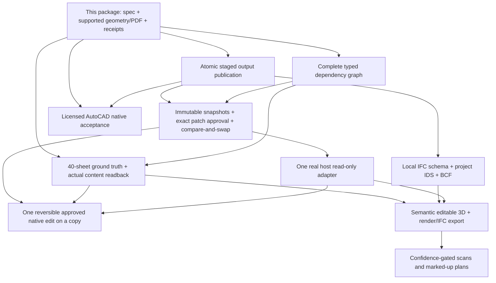

# Drawing verification — bounded implementation package

## Goal and evidence baseline

Deliver trustworthy **supported local 2D verification** before enlarging modeling or native integration claims. This is the first execution slice of the supplied `GRIDLINE_IMPLEMENTATION_MASTERPLAN_2026-10-23.md`, SHA-256 `9ee7419dcfe82c6cd3603f004b50c1b56368702bb1904e040e0e8ee59114f0d5`. The branch begins at `62a7ea4` (audit PR #19 merged); the only changes since audit baseline `a1c7797` are audit documentation. Issues #10–#16 remain the tracked program dependencies.

At `a1c7797`, deleting A-101 opening LINE B9 from (2000, -150) to (2000, 150) reduced opening LINE count 42→41 while tags and schedule bytes remained unchanged. The old checker returned exit 0 / PASS. New adversarial tests were run against unchanged production code first: geometry, PDF and receipt/validation cases failed before repair. Existing 11 CAD tests did not cover this defect.

## Scope and constraints

One coding agent owns an isolated feature worktree. Preserve both CLI entry points, legacy valid specs, installers, canonical skill packaging and Claude mirrors. Add only building-spec preconditions, an independent supported-primitive readback module, bounded byte snapshots/receipts, PDF vector checks, adversarial tests and related docs/CI. No new root framework or dependency on source-tree imports after skill installation.

No native architectural software write authority, licensed-model changes, unrelated worktree edits, autonomous issue or professional certification. No multi-agent benchmark or invented efficiency metric. The independent reviewer gate is requested on the PR; a self-review is not independent sign-off.

## Done criteria

1. Missing/moved/resized/duplicated opening, wall and room primitives fail even with unchanged labels/CSVs. Missing door arcs fail. Hand-authored reference geometry, rotated/translated plans and inferred legacy associations are exercised.
2. Explicit units, finite typed coordinates/dimensions, valid level elevation/height, IDs, host references and horizontal/vertical opening fit are enforced without traceback on tested malformed inputs.
3. Required PDF missing/malformed/blank/wrong-sheet/scale failures are detected by parsing its own page/vector stream. Visual fidelity remains separately unverified.
4. Receipts hash exact consumed spec/profile/artifact bytes and validator files, record dependency versions and source revision, preserve partial gate outcomes and report unsupported coverage.
5. Pinned-dependency CAD tests, provider parity, repository checks and appropriate installer checks pass. CAD CI refuses accidental missing-dependency skips. Independent critical review and final-head CI are release gates; keep the PR unmerged until review and authorization are satisfied.

## Dependency-ordered follow-up packages

The next storage package stages complete revision artifacts, validates an inventory, atomically publishes a manifest/pointer and preserves the previous revision under injected later-sheet failures. The dependency package must include grids/units/profile changes and wall→opening→detail/schedule transitive impacts. Neither is implemented here. MCP race-resistant file confinement and conceptual-renderer validation findings also remain open; local drawing snapshots do not repair the MCP server.

Native AutoCAD acceptance needs a supported licensed Windows host, actual native AUDIT/edit/plot/DWG roundtrip and operator receipts on copies. Revit's planned read-only pilot requires the documented host/version and a real licensed session. Exact platform/version/API support must be reverified when that package begins; no adapter availability is inferred from this plan. IFC/IDS and all host/3D gates are `NOT_RUN` in this package.

## Detailed-model completeness requirement

For briefs, images, maquettes and top-down drawings, maintain a source-detail inventory with source location, interpretation, scale/dimensions, confidence, target element IDs and implementation/verification state. Account for every provided detail; do not silently drop unsupported items. Missing/hidden/contradictory geometry must block the relevant model claim until resolved by the user. Every render/CAD/BIM export must be compared to that inventory, independently measured and roundtripped through the relevant tool before a completeness claim.

This is an acceptance requirement for semantic 3D/scanning packages, **not a shipped image-to-model capability**. Appearance alone cannot establish dimensional or semantic completeness. Native acceptance and professional human review remain necessary.
